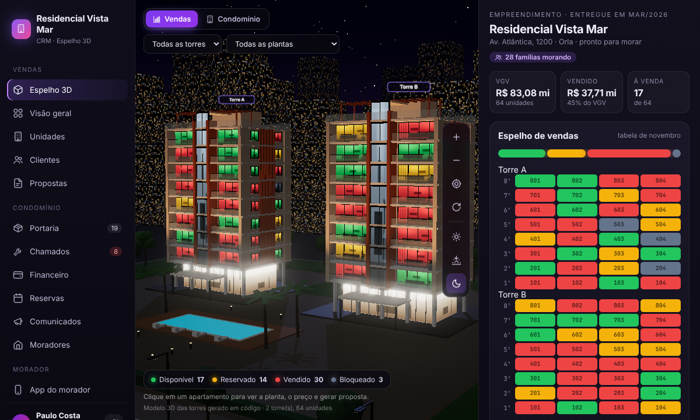

# CRM de Condomínio com Espelho 3D



> **Como publicar:** veja o passo a passo em [PUBLICAR.md](PUBLICAR.md).

CRM para incorporadora e condomínio, com o modelo 3D das torres, inspirado no vídeo de referência.

## Prévia no computador e no celular

Abra `preview.html` (pelo servidor local abaixo) para ver o sistema lado a lado num notebook e num celular, ambos funcionando.

## Como abrir

O app é estático (HTML, CSS e JavaScript, sem build). Como usa módulos JavaScript, precisa ser aberto por um servidor local, não com duplo clique:

```bash
cd crm-condominio
python3 -m http.server 8080
# abra http://localhost:8080 no navegador
```

Para publicar, basta subir a pasta inteira em qualquer hospedagem estática (Vercel, Netlify, HostGator, GitHub Pages).

## O que tem

- **Espelho 3D** (Three.js): torres modeladas em código, cidade ao fundo, iluminação dia / entardecer / noite, girar e zoom.
  - Modo **Vendas**: janelas coloridas por situação (disponível, reservado, vendido, bloqueado), filtro por torre e planta, planta 2D e **planta 3D mobiliada**, gerar proposta e reservar.
  - Modo **Condomínio**: encomendas, chamados e financeiro por apartamento, com marcadores no prédio e a ficha do morador (WhatsApp, entregar encomenda, cota em atraso com multa e juros, 2ª via Pix, marcar pago, consumo, histórico).
- **Telas**: Visão geral, Unidades, Clientes (funil kanban com arrastar e soltar), Propostas, Portaria (encomendas com foto, armários e visitantes), Chamados, Financeiro, Reservas, Comunicados e Moradores.
- **App do morador**: correspondências com QR / código de retirada, financeiro com Pix, chamados, reservas, minha unidade, reuniões, mural, documentos e consumo de água e gás comparado com a média do prédio.
- Funciona no celular (menu inferior) e no computador.

## Onde mudar as coisas

- `js/data.js` → `CONFIG`: nome do condomínio, incorporadora, síndica, **número de torres, andares e apartamentos por andar**, valor da cota, multa e juros. As plantas (`PLANTAS`) definem os ambientes da planta 3D.
- Os dados são de demonstração e ficam salvos no navegador (localStorage). O botão de restaurar na barra lateral volta ao estado inicial.

## Plantas 3D próprias e fachada

- **Plantas 3D**: coloque o arquivo `.glb` de cada planta na pasta `plantas/` e aponte em `js/data.js` (`modelo3d: 'plantas/P98.glb'`). Veja `plantas/LEIA-ME.txt`. Sem arquivo, o sistema usa a planta 3D gerada automaticamente.
- **Fachada**: cores, texturas e proporções ficam em `js/building3d.js` (constantes no topo: pé-direito, largura dos apartamentos, profundidade das varandas; materiais em `const M`).

## Próximos passos sugeridos

- Backend com banco de dados e login (gestor, portaria, morador).
- Envio real de WhatsApp (API oficial) e cobrança Pix real (integração com banco).
- Upload de fotos reais das encomendas e dos chamados.
